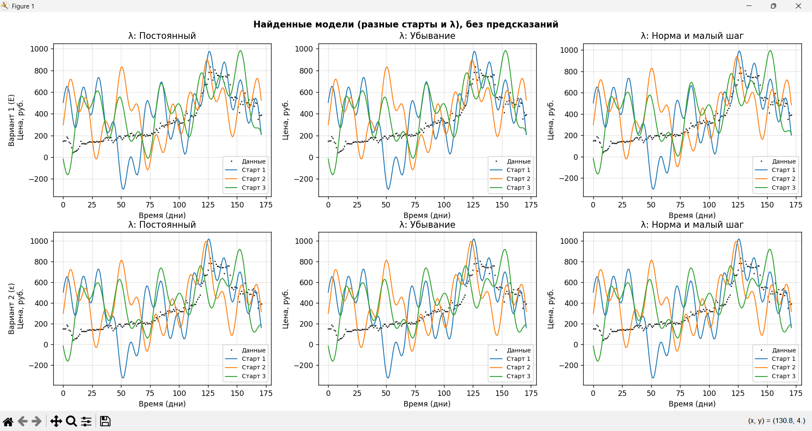
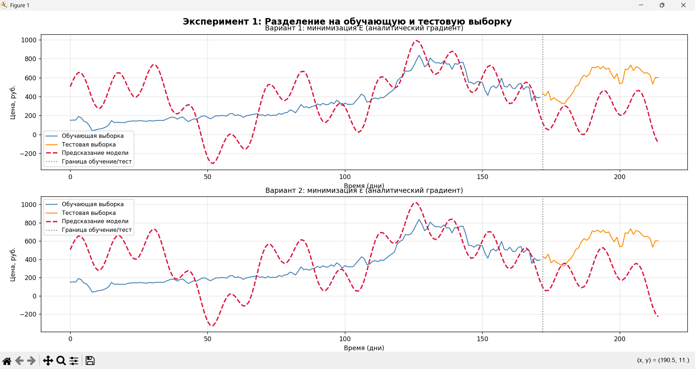
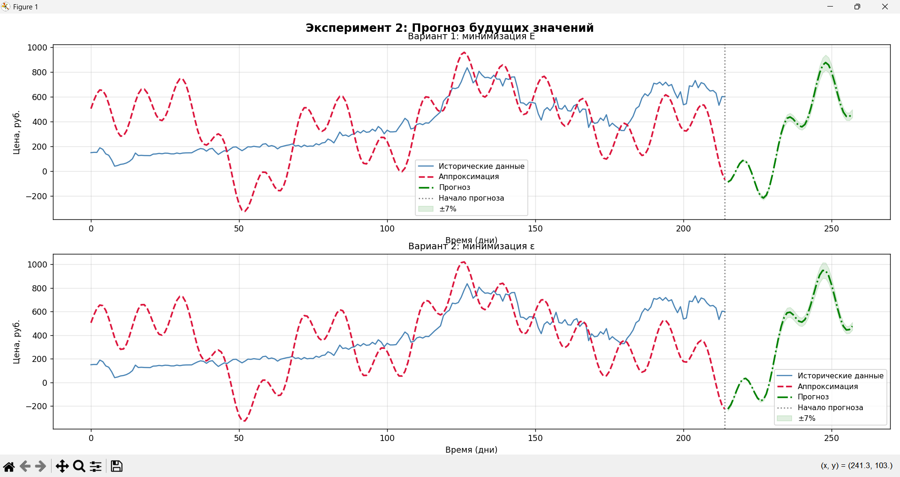
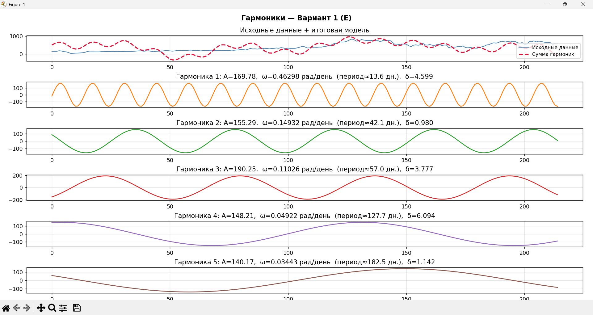
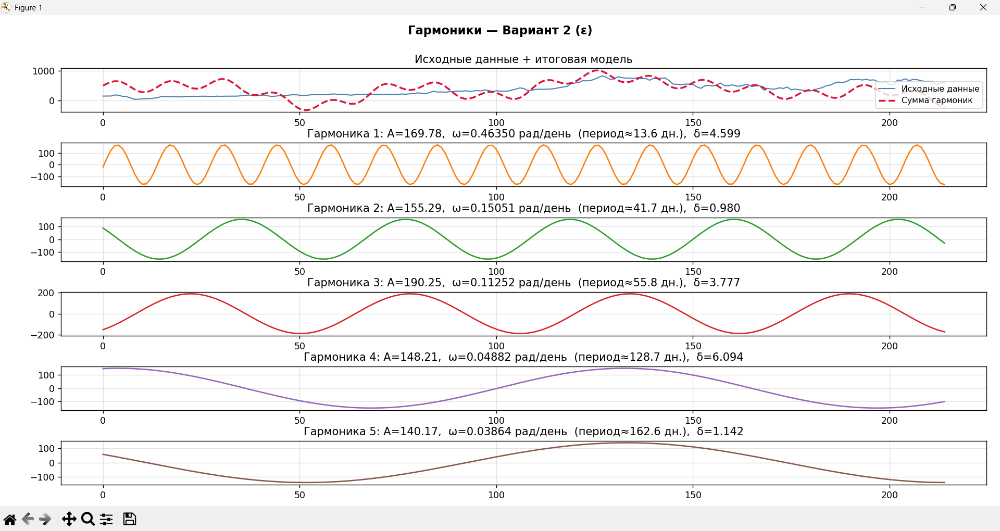
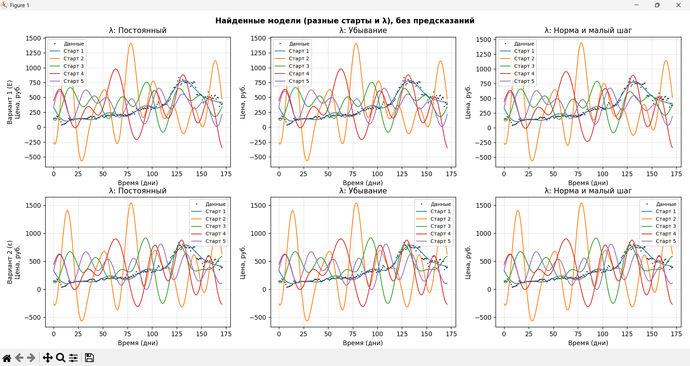
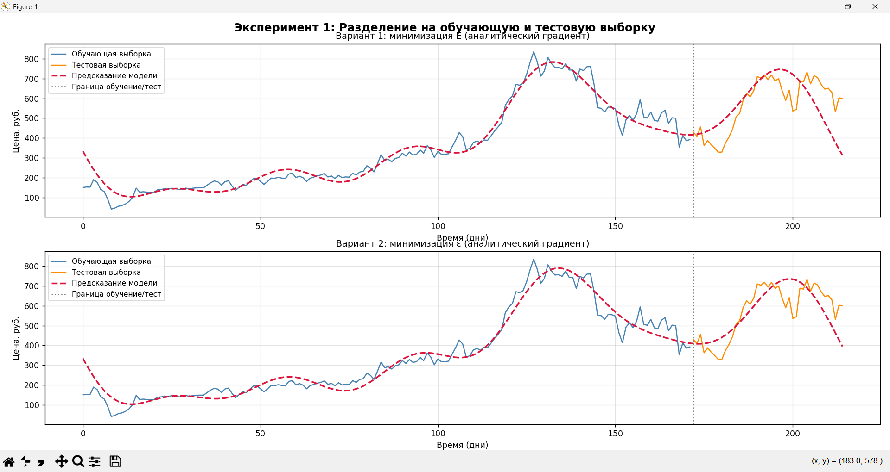
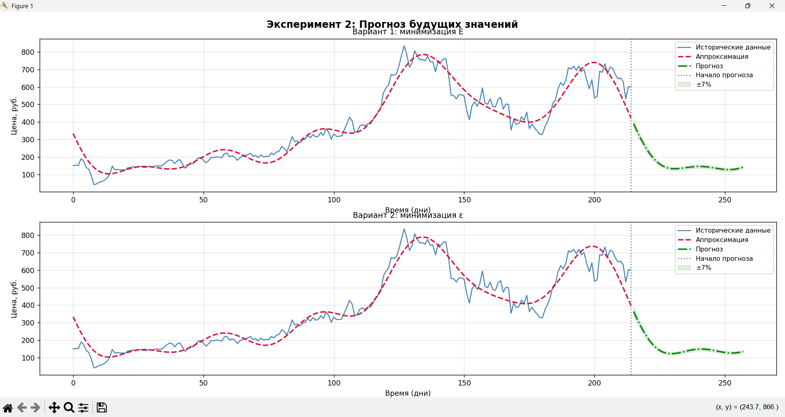
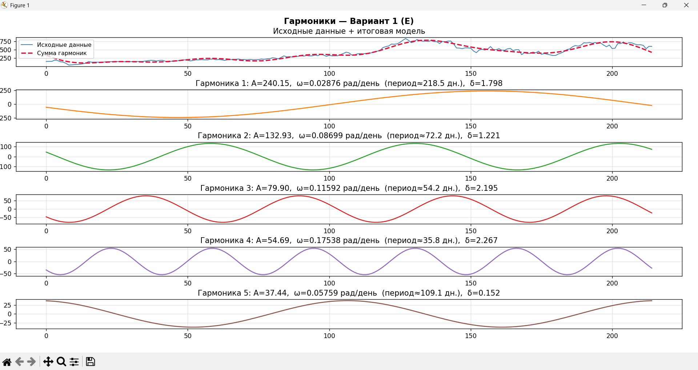
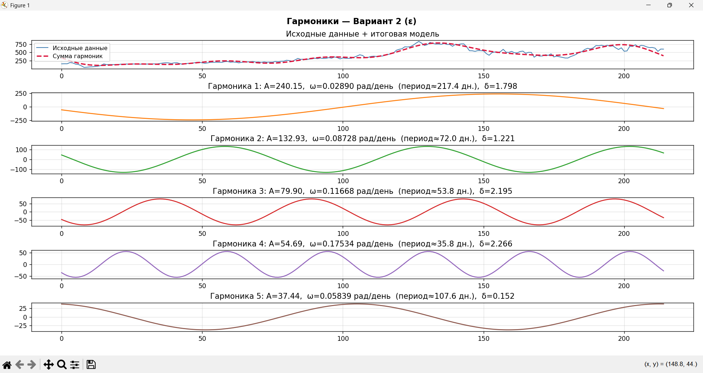

# Nonlinear Harmonic Approximation of Stock Prices

Нелинейная аппроксимация временного ряда котировок акций суммой тригонометрических гармоник. Параметры модели подбираются **градиентным спуском** с аналитическим градиентом в двух постановках оптимизации и трёх сценариях управления шагом обучения.

**Данные:** дневные котировки акций компании Татнефть (`TATN.xlsx`).

---

## Содержание

- [Идея проекта](#идея-проекта)
- [Теория](#теория)
- [Реализация](#реализация)
- [Установка и запуск](#установка-и-запуск)
- [Результаты](#результаты)
- [Структура репозитория](#структура-репозитория)

---

## Идея проекта

Линейная и обобщённая линейная регрессии плохо описывают волнообразные колебания цены. Здесь ряд моделируется суперпозицией пяти гармоник плюс постоянный фон - всего **16 свободных параметров**. Оптимизация выполняется итерационно методом градиентного спуска.

Сравниваются:

1. **Вариант 1** - прямая минимизация квадратичной ошибки $E$.
2. **Вариант 2** - минимизация невязки системы уравнений стационарности $\varepsilon$.

Для каждого варианта исследуются три сценария шага $\lambda$: постоянный, экспоненциальное убывание, нормализация направления градиента с последующим малым шагом. Стартовые точки берутся случайно и из FFT-оценки спектра ряда.

---

## Теория

### 1. Нелинейная модель на основе суммы гармоник

Пусть имеется набор наблюдений $y_i$ в моменты времени $t = 0, 1, \ldots, N-1$. Данные описываются моделью:

$$
m(t) = b + \sum_{k=1}^{5} A_k \cos(\omega_k t + \delta_k)
\qquad (1)
$$

где:

- $b$ - постоянная составляющая (фон, смещение);
- $A_k$ - амплитуда $k$-й гармоники;
- $\omega_k$ - угловая частота $k$-й гармоники (рад/день);
- $\delta_k$ - начальная фаза $k$-й гармоники.

Каждая из пяти гармоник имеет три свободных параметра $(A_k, \omega_k, \delta_k)$, плюс один параметр фона $b$. Итого **16** параметров:

$$
\theta = (b,\; A_1, \omega_1, \delta_1,\; A_2, \omega_2, \delta_2,\; \ldots,\; A_5, \omega_5, \delta_5)
$$

Задача сводится к поиску $\theta$ численным методом - градиентным спуском.

---

### 2. Вариант 1: минимизация квадратичной ошибки $E$

Целевая функция - сумма квадратов отклонений модели от данных:

$$
E(\theta) = \sum_{i} \Big( b + \sum_{k=1}^{5} A_k \cos(\omega_k t_i + \delta_k) - y_i \Big)^2
$$

или, короче,

$$
E(\theta) = \sum_{i} \big( m(t_i) - y_i \big)^2
$$

Для градиентного спуска нужны частные производные.

**Производная по фону $b$:**

$$
\frac{\partial E}{\partial b} = \sum_{i} 2\big(m(t_i) - y_i\big)
$$

**Производная по амплитуде $A_k$:**

$$
\frac{\partial E}{\partial A_k} = \sum_{i} 2\big(m(t_i) - y_i\big) \cdot \cos(\omega_k t_i + \delta_k)
$$

**Производная по частоте $\omega_k$:**

$$
\frac{\partial E}{\partial \omega_k} = \sum_{i} 2\big(m(t_i) - y_i\big) \cdot \big(-A_k \, t_i \, \sin(\omega_k t_i + \delta_k)\big)
$$

**Производная по фазе $\delta_k$:**

$$
\frac{\partial E}{\partial \delta_k} = \sum_{i} 2\big(m(t_i) - y_i\big) \cdot \big(-A_k \, \sin(\omega_k t_i + \delta_k)\big)
$$

Полный аналитический градиент - вектор из 16 компонент:

$$
\nabla E = \left(
\frac{\partial E}{\partial b},\;
\frac{\partial E}{\partial A_1},\;
\frac{\partial E}{\partial \omega_1},\;
\frac{\partial E}{\partial \delta_1},\;
\ldots,\;
\frac{\partial E}{\partial A_5},\;
\frac{\partial E}{\partial \omega_5},\;
\frac{\partial E}{\partial \delta_5}
\right)
$$

Шаг градиентного спуска:

$$
\theta^{(i+1)} = \theta^{(i)} - \lambda_i \, \nabla E\big(\theta^{(i)}\big)
\qquad (2)
$$

где $\lambda_i$ - параметр шага на $i$-й итерации.

---

### 3. Вариант 2: минимизация невязки системы уравнений стационарности

В точке истинного минимума $E$ все компоненты градиента равны нулю - получается система из 16 уравнений:

$$
\nabla E(\theta) = 0
$$

Вместо прямой минимизации $E$ ищется точка, в которой левые части этих уравнений в совокупности ближе всего к нулю. Вводится вспомогательная целевая функция - сумма квадратов компонент градиента:

$$
\varepsilon(\theta) =
\sum_{k=1}^{5}
\left[
\left(\frac{\partial E}{\partial \omega_k}\right)^2 +
\left(\frac{\partial E}{\partial \delta_k}\right)^2 +
\left(\frac{\partial E}{\partial A_k}\right)^2
\right]
+
\left(\frac{\partial E}{\partial b}\right)^2
$$

Свойства:

- $\varepsilon(\theta) \ge 0$;
- $\varepsilon(\theta) = 0$ тогда и только тогда, когда $\theta$ - точное решение системы стационарности.

Градиент $\varepsilon$ через гессиан $E$:

$$
\nabla \varepsilon = 2 \, H_E \, \nabla E
$$

где $H_E = \nabla^2 E$ - матрица вторых производных размера $16 \times 16$, также вычисляемая аналитически. Далее к $\varepsilon$ применяется тот же градиентный спуск (2).

---

### 4. Сценарии управления шагом $\lambda$

Параметр шага критичен для сходимости:

- слишком большой $\lambda$ - расходимость или колебания около минимума;
- слишком малый $\lambda$ - медленная сходимость.

В проекте используются три сценария:

| Сценарий | Описание |
|----------|----------|
| **Const** | постоянный шаг $\lambda = \mathrm{const}$ |
| **Decay** | экспоненциальное убывание: $\lambda_{i+1} = \gamma \, \lambda_i$, $\gamma < 1$ |
| **NormSmall** | первые $N_{\mathrm{norm}}$ итераций - шаг фиксированной длины в направлении нормализованного градиента, затем малый постоянный шаг |

Дополнительно применяется **проекция параметров** (`separate`): амплитуды ограничиваются, частоты $\omega_k$ разводятся, чтобы гармоники не сливались в одну.

---

### 5. Метрики качества

$$
\mathrm{RMSE} = \sqrt{\frac{1}{n}\sum_{i=1}^{n}(y_i - \hat{y}_i)^2},
\qquad
\mathrm{MAE} = \frac{1}{n}\sum_{i=1}^{n}|y_i - \hat{y}_i|
$$

Выборка делится на обучение / тест в пропорции **80% / 20%**. Также строится экстраполяция на горизонт $0.2\,N$ вперёд с полосой $\pm 7\%$.

---

## Реализация

| Функция | Назначение |
|---------|------------|
| `load_data` | загрузка цен закрытия из `TATN.xlsx` |
| `init_params` | старт: FFT-оценка или случайная инициализация |
| `model` | вычисление $m(t)$ по формуле (1) |
| `loss_E` / `grad_E` | целевая $E$ и аналитический $\nabla E$ |
| `loss_eps` / `hess_E` / `grad_eps` | целевая $\varepsilon$, гессиан и $\nabla\varepsilon$ |
| `separate` | проекция амплитуд и частот |
| `gradient_descent` | итерации спуска с тремя сценариями $\lambda$ |
| `plot_*` | визуализация train/test, прогноза, гармоник, мультистартов |

---

## Установка и запуск

```bash
git clone https://github.com/<username>/harmonic-time-series-approximation.git
cd harmonic-time-series-approximation

python -m venv .venv
# Windows:
.venv\Scripts\activate
# Linux / macOS:
# source .venv/bin/activate

pip install -r requirements.txt
python harmonic_gradient_descent.py
```

Скрипт сохранит графики (`result_*.png`, `harmonics.png`) в рабочей директории и покажет окна Matplotlib.

---

## Результаты

### Случайная инициализация

При случайных стартах модели чувствительны к начальной точке и сценарию $\lambda$. Нормализация градиента даёт более стабильное поведение, постоянный шаг чаще приводит к плохой сходимости.



На hold-out тесте прямая минимизация $E$ сильнее подстраивается под обучающую выборку и хуже обобщается; минимизация $\varepsilon$ ведёт себя устойчивее, но обе модели ограничены по точности прогноза.









### Инициализация из FFT

Стартовые параметры из спектрального анализа ряда задают точку вблизи разумного оптимума. Все три сценария $\lambda$ сходятся к близким моделям, хорошо повторяющим форму исходного ряда.







Разложение итоговой модели на отдельные гармоники (фон + 5 компонент):





**Вывод:** качество аппроксимации сильно зависит от инициализации. FFT-старт заметно стабилизирует спуск и улучшает интерпретируемость периодов гармоник. Вариант с $\varepsilon$ полезен как альтернативная постановка задачи стационарности, а сценарий NormSmall - как более устойчивая схема шага для нелинейной модели.

---

## Структура репозитория

```
harmonic-time-series-approximation/
├── README.md
├── requirements.txt
├── .gitignore
├── harmonic_gradient_descent.py   # основной скрипт
├── TATN.xlsx                      # котировки TATN
└── images/                        # скриншоты результатов
    ├── 01_random_starts_models.png
    ├── 02_train_test_random.png
    ├── 03_forecast_random.png
    ├── 04_harmonics_E_random.png
    ├── 05_harmonics_eps_random.png
    ├── 06_fft_starts_models.png
    ├── 07_train_test_fft.png
    ├── 08_forecast_fft.png
    ├── 09_harmonics_E_fft.png
    └── 10_harmonics_eps_fft.png
```

## Стек

Python · NumPy · Pandas · Matplotlib · openpyxl
